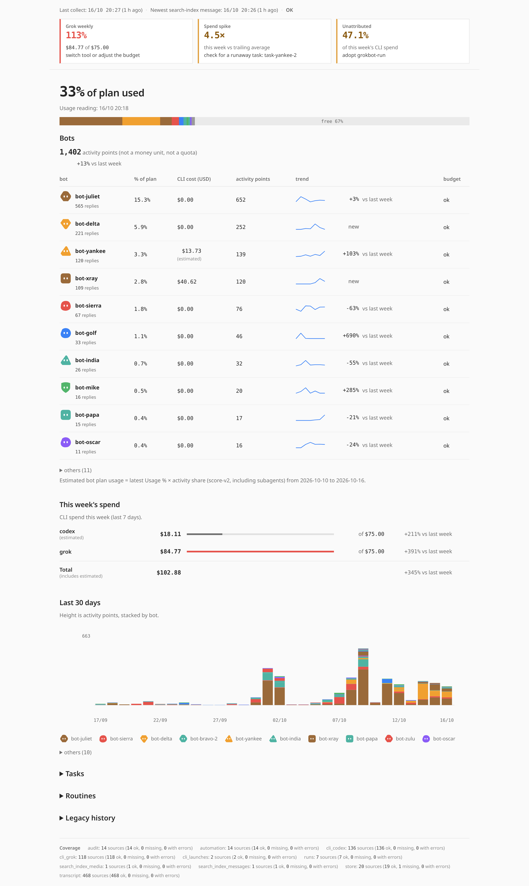

# grokbot-quota

A small, read-only tracker for a team of Grok Bots. It shows which bots, children, and routines are active, and it records CLI sessions from Claude, Codex, and Grok.



The picture is an anonymized dashboard: names and ids are stable stand-ins. A narrow capture is [docs/dashboard-mobile.png](docs/dashboard-mobile.png). `scripts/screenshot.sh` rebuilds the fake demo and captures it. `scripts/screenshot.sh --real-db PATH` anonymizes that database first.

Python 3 standard library only (`sqlite3`, `json`, `zoneinfo`). No packages, server, or CDN.

## What it measures

Activity is a **proxy**, not a quota balance. The sources do not expose the product quota, hidden reasoning, or the billed model for a bot.

`score-v2` ranks activity:

```
score = 1.0×inference_steps + 0.5×tool_calls + 5×child_launches + 0.2×computer_actions
      + 1×screenshots + 1×root_requests + 1×proxy_replies + observed_text_bytes / 4000
```

`direct` is what an entity did itself. `inclusive` adds descendants. Do not add inclusive totals across bots.

CLI spend is separate and is **not** part of the score:

* `cost_usd` is the price the tool reported. Claude result lines and Grok `usage.json` supply this. It is real for that CLI session.
* Codex does not report a price. `cost_usd_est` is an **estimate** from `config/prices.json` (USD per 1M tokens). The panel and the summary mark it `estimated`.
* A reported `cost_usd` is never replaced by an estimate.

## What it does not measure

* The bot product's quota, remaining allowance, or a percentage of quota.
* Tokens, cached context, or effort for bot transcripts. Those sources have counts and byte sizes only.
* Message text, prompts, tool arguments, tool results, URLs, page titles, shell commands, or file names. The synthetic fixtures plant `CANARY` strings and the tests check that none of them land in the database or the HTML.
* The working directory is the exception: `cli_runs.cwd` and `cli_launches` keep it so a launch can be matched to a run.

Days are Europe/Lisbon. Transcript lines often have no timestamp, so backfill timing is interpolated. Search-index days are exact but are a weaker proxy than a full transcript (one visible reply can hide many tool calls). Compare bots inside the same kind of coverage.

## Components

| Piece | Role |
|---|---|
| `quota/collect.py` | Incremental, read-only collection into `quota.db` |
| `quota/attribute.py` | Rebuilds parent, child, and routine links |
| `quota/report.py` | `panel.html` and the text summary |
| `quota/dashboard.py` | Self-contained HTML dashboard (`--anonymize` rewrites identifiers first) |
| `quota/leakguard.py` | Fails if a file still contains real names, ids, or paths |
| `quota/anonymize.py` | Stable stand-ins: `bot-alpha`, fake ids, generic paths |
| `quota/alerts.py` | Budget, spike, paused, unattributed, and stale alert rules |
| `quota/budgets.py` | Daily and weekly CLI spend limits (`EXCESSIVE:` lines) |
| `quota/prices.py` | Codex price table and estimates |
| `quota/trends.py` | Week-over-week figures for the dashboard |
| `quota/schema.sql` | Tables and views |
| `quota/detect.py` | Read-only inventory of which sources exist |
| `quota/paths.py` | Data root, database, output, and session paths |
| `quota/plugins/sqlite_tasks.py` | Optional task to bot map. Off by default |
| `bin/grokbot-run` | Records one CLI launch, then execs the tool |
| `bin/quota-daily` | Weekday pass that stays quiet unless a budget line fires or a command fails |
| `config/budgets.json` | Spend limits |
| `config/prices.json` | Codex rates, with the source URL and check date |
| `config/quota.json` | `attribution_plugins` (empty) and `tasks_db` |
| `examples/` | Synthetic agent-data and CLI fixtures |
| `quota/demo.py` | Fake database and `docs/demo/dashboard.html` |
| `scripts/screenshot.sh` | Headless Chrome captures. `--real-db PATH` anonymizes that database first |

`python3 -m quota.detect` prints which of these exist, with file counts and sizes: the agent-data root, `search-index.db`, `agents/*/audit.jsonl`, `agents/*/store.db`, `agent-transcripts`, Claude report jsonl, Codex sessions, Grok sessions, and `launches.jsonl`. It only lists and stats files.

Paths come from the environment. See `SETUP.md` for the first run. Nothing in this tree hardcodes a home directory, a username, or a machine name.

## Attribution

Launch tags win. `bin/grokbot-run` writes `launches.jsonl`. A CLI run with the same tool and `session_id` is `launch_session`. Otherwise the nearest unused launch of the same tool, matching cwd or task, within 24 hours, is `launch_cwd`.

Anything left over is `plugin` when an attribution plugin returns a bot id, or `unattributed`. Plugins are off until `config/quota.json` lists one, or `QUOTA_ATTRIBUTION_PLUGIN=module:function` is set. The example reads a generic projects/tasks sqlite file. Schema: `examples/tasks.sql`.

## Fixture ids

Tests and `examples/` use made-up ids of this shape only:

`00000000-0000-4000-8000-` plus twelve hex digits `0000000000NN`, where `NN` is two hex digits.

| Id ending | Used as |
|---|---|
| `01` | sample bot (profile name Alpha Bot) |
| `02` | sample bot (profile name Beta Bot) |
| `03` | sample bot in the CLI tests |
| `04` | sample bot in the CLI tests |
| `09` | sample bot in the CLI tests |
| `0a` | sample child, prefixed `sand-subagent-` |

They are not live agents. A public scan for UUID-shaped strings will hit these and nothing else.

## Demo

```sh
python3 -m quota.demo [--db PATH] [--out PATH] [--seed N]
```

This writes a deterministic fake quota database and builds the dashboard from it. The default HTML path is `docs/demo/dashboard.html`. The database goes to a temporary directory unless `--db` is set. `*.db` stays gitignored.

Eight invented bots (Atlas, Juniper, Pixel, Nova, Orbit, Maple, Comet, Quill) use the fixture id shape above, endings `01` through `08`. About four weeks of daily activity end today. CLI rows cover claude, codex, and grok on tasks `JOB-1` and up. One tool sits near 90% of its weekly budget and does not go over it. Unattributed CLI spend is over 20%. Those two alerts are the ones the demo is meant to show. Avatars are generated SVG shapes. No PNG avatars are written.

`scripts/screenshot.sh` loads that HTML in headless Chrome and writes `docs/dashboard.png` (1280 CSS pixels wide, full page) and `docs/dashboard-mobile.png` (390 CSS pixels wide). With no argument it rebuilds the fake demo first. `--real-db PATH` builds an anonymized page from that database instead.

## Anonymized dashboard

```sh
python3 -m quota.dashboard --anonymize [--db PATH] [--out PATH]
python3 -m quota.leakguard --db PATH FILE...
```

`--anonymize` opens the database read-only and rewrites the rows in memory before rendering. Bot names become `bot-alpha`, `bot-bravo`, and so on. Agent, conversation, and request ids become stable fake ids. Filesystem paths are rewritten under `/home/user/...`. Email addresses become one example address. Tailnet hosts become example hosts. A short list of personal names becomes `user`. The mapping stays the same for that build. Costs, points, and dates stay. The command then runs the leak guard on the HTML. If anything real remains, it exits 1 and does not write the file.

`quota.leakguard` collects bot names, agent ids, working directories, and UUIDs from the database, adds the fixed denylist, and scans each file. A hit prints `PATH: term` and exits 1.

## Limits

Store and search-index rows are keyed by entry id. An edited body is not re-read. Deleted mirror rows stay in the ledger. Scheduling is one weekday routine you add yourself (`SETUP.md`), not a built-in daemon.

Record the plan's Usage % to estimate each bot's share in the dashboard:

```sh
python3 -m quota.usage add 2026-10-16 42 --db /path/to/quota.db
python3 -m quota.usage list --db /path/to/quota.db
python3 -m quota.usage fit --db /path/to/quota.db
```

Readings store a timestamp; adding the same day replaces its reading. `fit` calibrates usage changes against activity once enough readings exist. Without a reading, the dashboard still shows the activity ranking.
